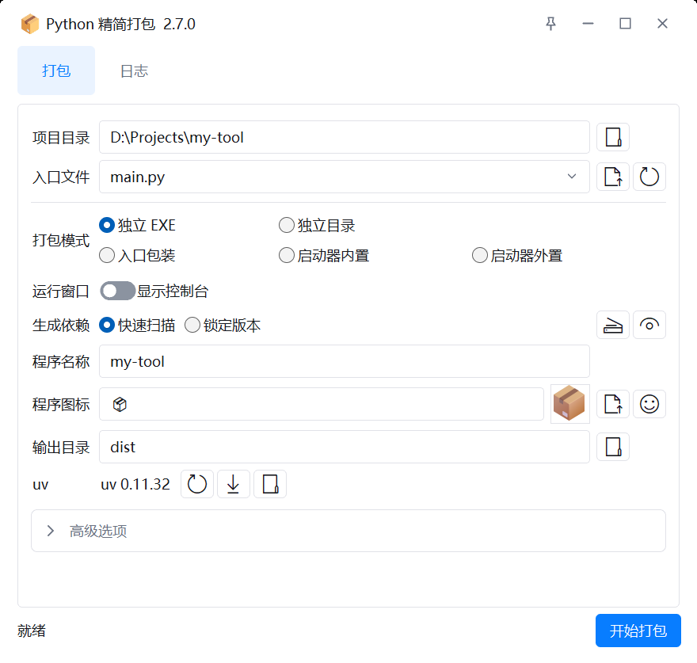
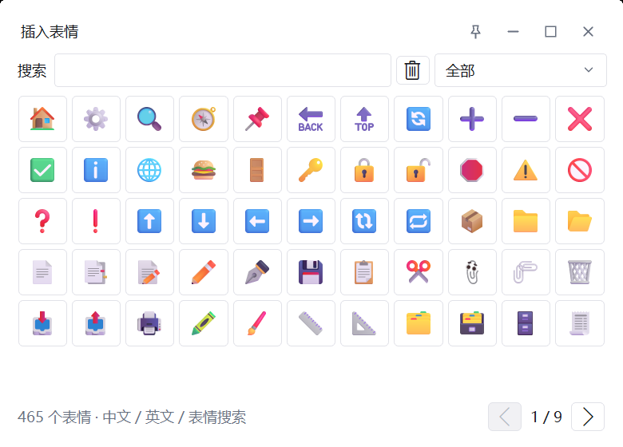

# Simple Packager · Python 精简打包

Windows 下的 Python 图形化打包工具：用 `uv` 在干净的隔离环境里调用 PyInstaller 打包，免去手动建虚拟环境、配依赖、找图标的麻烦；也可以直接生成几十 KB 的系统 Python 启动器。

- **隔离环境打包**：自动从入口扫描实际依赖，由 `uv` 临时准备纯净环境再运行 PyInstaller，不污染本机环境，且多项目共享缓存。
- **支持轻量启动器**：目标电脑已有 Python 时，可生成极小的单文件启动器 EXE，构建无需 `uv`。
- **彩色表情 / 文字图标**：支持 `.ico`，也可以直接选表情或输入文字，实时预览并自动生成多尺寸透明图标。
- **GUI + CLI 双入口**：双击 `main.py` 打开界面；带参数运行就是命令行工具，方便脚本或 AI 调用。



## 快速开始

### 方式一：直接下载 EXE（推荐）

前往 [Releases](https://github.com/bvb6417/simple-packager/releases) 页面下载打包好的可执行文件：

- **`SimplePackager-v2.7.1-standalone.exe`**（独立版，约 11.3 MB）：内置 Python 与 `tkwebui`，无需配置 Python 环境，下载双击即可运行。
- **`SimplePackager-v2.7.1-launcher-source.exe`**（启动器外置资源版，约 140 KB）：内置项目全部 Python 源码，调用本机 PATH 中的 `python.exe` 运行（需本机已执行 `python -m pip install tkwebui>=0.3.2`）。

### 方式二：从源码运行

需要 **Windows 10/11** 和 **Python 3.10+**（含 Tkinter）：

```powershell
git clone https://github.com/bvb6417/simple-packager.git
cd simple-packager
python -m pip install -r runtime-requirements.txt
python main.py
```

> 使用独立打包模式需要 `uv`；本机没装的话，打开界面后直接点 `uv` 旁的下载按钮即可一键安装。

## 基本用法

1. **选择项目**：点击浏览按钮选择项目目录，或直接把项目文件夹拖进「项目目录」框（也可以把入口 `.py` 拖进「入口文件」框）。
2. **选择模式**：按需要选打包模式，并用「显示控制台」开关控制运行时是否弹出黑框。
3. **扫描依赖**（独立打包）：点击「生成依赖」旁的扫描图标，自动生成 `runtime-requirements.txt`；旁边的预览图标可打开核对。
4. **设置名称与图标**：填好程序名称，图标可以选 `.ico` 文件、直接输入文字/表情，或点右侧表情按钮挑选。
5. **开始打包**：点击右下角「开始打包」，可在「日志」页查看实时进度，完成后自动打开输出目录。

## 打包模式

| 模式 | 说明 | 目标电脑需要 Python？ | 适合场景 |
| --- | --- | --- | --- |
| **独立 EXE** | 单个可执行文件（`--onefile`），内置 Python 与依赖 | 不需要 | 发给没装 Python 的人，最省心 |
| **独立目录** | 包含完整运行环境的文件夹（`--onedir`） | 不需要 | 启动更快，适合稍大的程序 |
| **入口包装** | 仅包装所选入口脚本（几十 KB），其他模块和资源留在 EXE 旁 | 需要（PATH 中的 `python.exe`） | 给本地脚本套 EXE 壳、设图标、藏黑框，改其他模块免重打包 |
| **启动器内置** | 单文件轻量 EXE，内置项目源码和资源（不含 Python 环境） | 需要 | 在已有相同环境的电脑间传小工具 |
| **启动器外置** | 仅内置 `.py` 源码（不含 Python 环境），图片/配置等资源放 EXE 旁 | 需要 | 资源文件较大、希望与源码分开更新 |

## 图标与表情选择

在「程序图标」框里输入文字或表情，右侧会实时显示 48px 彩色预览；点击最右侧的表情按钮可以打开内置面板，支持 465 个彩色表情的分类筛选与中英文搜索，无需额外安装 Pillow。



## 几点提示

- **核对依赖**：自动扫描覆盖大多数常见依赖，但动态导入，或 import 名与 pip 包名不一致（例如 `PIL` 对应 `Pillow`、`docx` 对应 `python-docx`）时，请手动修改依赖文件，或在「高级选项 → 隐藏导入」中补充。
- **按项目记忆配置**：每个项目的打包参数会自动保存在工具目录的 `项目打包配置/` 文件夹下，下次打开同一项目直接复用。
- **保持项目目录干净**：打包前尽量把项目放在独立文件夹里，避免直接选择桌面或混有无关文件的目录。
- **网络与缓存**：独立打包内置国内镜像与自动切换，首次打包需联网，后续会复用本地 `uv` 缓存。

## 命令行 / AI 调用

带子命令运行即进入 CLI 模式（不启动 GUI），支持 `--json` 输出。如果交给 Codex、Claude Code 等 AI 工具调用，直接让它执行 `--help` 查看全部参数即可：

```powershell
python main.py --help
python main.py build --help
```

可用子命令：`doctor`（检查环境）、`scan`（扫描依赖）、`preview`（预览构建计划）、`build`（执行打包）。
